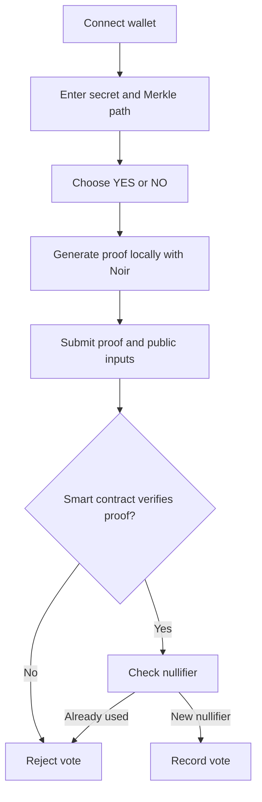

<div align="center">

# 🕶️ VeilVote

### Your vote. Your secret. Nobody needs to know.

**A privacy-first voting dApp exploring zero-knowledge proofs, Merkle-tree eligibility, and on-chain double-vote prevention.**

[](https://soliditylang.org/)
[](https://noir-lang.org/)
[](https://sepolia.etherscan.io/)
[](https://react.dev/)
[](https://vitejs.dev/)

*Prove you're eligible to vote — without putting your secret on-chain.*

</div>

---

## ✨ The idea

Traditional on-chain voting is transparent by default: transactions are public, and the data submitted with them can reveal more than voters intend.

**VeilVote explores a different approach.** A voter supplies their secret and Merkle-path credentials locally, generates a zero-knowledge proof in the browser, and submits the proof to a smart contract for verification.

The goal: verify the rules of a vote without publishing the voter's secret or Merkle path.

> **Privacy principle:** private credentials stay client-side; only the proof and the inputs needed for on-chain verification are submitted.

## 🗳️ How it works


## Working Video


https://github.com/user-attachments/assets/de7ec419-be8d-4d86-9396-9e449722f8fc


### Voter journey

1. **Connect** a wallet such as MetaMask on Ethereum Sepolia.
2. **Provide credentials** — the secret, Merkle path, and path indices needed to demonstrate membership in the configured voter tree.
3. **Choose a side** — YES or NO.
4. **Prove locally** — Noir and Barretenberg generate a proof in the browser.
5. **Submit** — the wallet signs a transaction carrying the proof and public inputs.
6. **Verify on-chain** — the contract checks the proof and rejects a previously used nullifier.

The Merkle path is not a password and does not automatically need to be secret. The privacy objective is to avoid sending the secret and path to a backend or publishing them on-chain.

## 🔐 What is public, and what stays private?

| Data | Intended handling |
|---|---|
| Voting secret | Private; never submit it to the contract |
| Merkle path and path indices | Supplied by the voter; kept client-side |
| Zero-knowledge proof | Submitted on-chain for verification |
| Merkle root | Public poll configuration |
| Poll ID | Public |
| Nullifier | Public, so the contract can prevent reuse |
| Vote choice | Must be cryptographically bound to the proof and handled consistently by the contract |

**Important:** a public blockchain exposes transaction calldata and events. A zero-knowledge proof does not make every transaction detail private by itself. Privacy depends on the circuit, public inputs, contract logic, and event design working together.

## 🧱 Tech stack

| Layer | Technology |
|---|---|
| Frontend | React, TypeScript, Vite |
| Wallet | EIP-1193 provider / MetaMask |
| ZK circuit | Noir |
| Proof backend | `@noir-lang/noir_js`, `@aztec/bb.js` (Barretenberg / UltraHonk) |
| Smart contracts | Solidity |
| Development & deployment | Foundry (`forge`, `cast`) |
| Network | Ethereum Sepolia testnet |

## 🏗️ Architecture

```text
┌───────────────────────────── Browser ─────────────────────────────┐
│                                                                    │
│  Voter credentials ──► Noir witness generation ──► ZK proof       │
│  (secret + Merkle path)                      │                     │
│                                               ▼                     │
│                                      Public inputs                 │
└───────────────────────────────────────────────┬────────────────────┘
                                                │ Wallet transaction
                                                ▼
                                      ┌──────────────────┐
                                      │  Voting.sol      │
                                      │                  │
                                      │ Verify proof     │
                                      │ Check nullifier  │
                                      │ Record vote      │
                                      └────────┬─────────┘
                                               │
                                               ▼
                                         Ethereum Sepolia
```

## 🚀 Getting started

### Prerequisites

Install the following before running the project:

- Node.js and npm
- A browser wallet, such as MetaMask
- Foundry, if you want to build or test the Solidity contracts
- Noir / Nargo and the compatible Barretenberg tooling, if you want to rebuild the circuit and verifier

### 1. Clone the repository

```bash
git clone https://github.com/Aditya-alchemist/Zk-merkle-voting.git
cd Zk-merkle-voting
```

### 2. Install frontend dependencies

Run this in the frontend directory containing `package.json`:

```bash
npm install
npm run dev
```

Vite prints the local development URL in the terminal.

### 3. Build the Noir circuit

From the `Circuits/` directory:

```bash
nargo compile
nargo execute
```

`nargo execute` uses the configured `Prover.toml` test inputs. Treat those inputs as development fixtures, not real voter credentials.

### 4. Build and test the contracts

From the `contracts/` directory:

```bash
forge build
forge test
```

For deployment, configure your Sepolia RPC endpoint and wallet private key through environment variables. **Never commit `.env` files, seed phrases, or private keys.**

## 🌐 Sepolia deployment

The project has been deployed to Ethereum Sepolia for development:

| Contract | Address |
|---|---|
| `HonkVerifier` | [`0xa768B1161d241f7b6eE2b05FC405F4c6C0EF24EA`](https://sepolia.etherscan.io/address/0xa768B1161d241f7b6eE2b05FC405F4c6C0EF24EA) |
| `Voting` | [`0xa955Ad299223b606c9d2daC22450CE8808Dd7b8E`](https://sepolia.etherscan.io/address/0xa955Ad299223b606c9d2daC22450CE8808Dd7b8E) |

- **Network:** Ethereum Sepolia
- **Chain ID:** `11155111`
- **Configured poll ID:** `1`
- **Configured Merkle root:** `0x0eb0099d63346709ad8d46ec374e850cd1df95d4181874f1784b87a4628abbe1`

> **Deployment caution:** confirm that the deployed verifier was generated from the exact circuit and verification key used by the frontend. The checked-in verifier configuration has reported `NUMBER_OF_PUBLIC_INPUTS = 11`, while the current Noir circuit declares three public inputs (`merkle_root`, `poll_id`, and `nullifier`). Resolve and test that compatibility before relying on vote submission.

## 🛡️ Security notes and current scope

VeilVote is an experimental project for learning and demonstrating ZK-enabled voting. It is **not audited and is not suitable for real elections or valuable assets**.

Before treating it as production-ready, verify at least the following:

- [ ] The verifier and circuit artifacts come from the same exact circuit build.
- [ ] The public-input count and ordering match across Noir, proof generation, verifier, and contract.
- [ ] The vote choice is constrained by the proof and cannot be swapped when submitting the transaction.
- [ ] Nullifiers are correctly derived and cannot be reused for the same poll.
- [ ] Poll configuration, voter-tree root, and poll ID are validated.
- [ ] Test coverage includes invalid paths, wrong roots, wrong poll IDs, malformed proofs, reused nullifiers, and vote-choice tampering.
- [ ] The frontend does not transmit private credentials to a server or log them.
- [ ] The project receives an independent security review before any real-world use.

A valid Merkle proof demonstrates membership relative to a configured root; it does not, by itself, prove that the root was built fairly or that voter registration was trustworthy.

## 🗺️ Roadmap

- [x] Noir circuit for Merkle membership and poll-specific nullifier constraints
- [x] React/Vite voting interface
- [x] Browser-side proof-generation integration
- [x] Sepolia test deployment
- [ ] Align and verify circuit / verifier artifacts
- [ ] Bind the selected vote choice to the proof
- [ ] Add comprehensive circuit, contract, and end-to-end tests
- [ ] Replace demo credentials with a safe, user-controlled credential workflow
- [ ] Independent security review

## 🤝 Contributing

Issues, ideas, and pull requests are welcome. If you find a security issue, avoid publishing exploitable details before contacting the maintainer privately.

## 👨‍💻 Author

**Aditya Kumar Mishra**

- GitHub: [@Aditya-alchemist](https://github.com/Aditya-alchemist)
- LinkedIn: [Aditya Kumar Mishra](https://www.linkedin.com/in/aditya-kumar-mishra-alchemy/)

---

<div align="center">

**VeilVote — verify eligibility, not identity.** 🕶️

*Built to explore the intersection of zero-knowledge proofs and transparent smart contracts.*

</div>


